.
###

  
  
  
  
  
 
  
  
  
 
  
  
  
  
  
  

###

 

  <!-- GitHub Streak -->
  

###

 

<picture data-importer="pacman">
  <source
    media="(prefers-color-scheme: dark)"
    srcset="https://raw.githubusercontent.com/KamalAboueidd/KamalAboueidd/pacman-output/pacman-contribution-graph-dark.svg?game=pacman"
  />
  <source
    media="(prefers-color-scheme: light)"
    srcset="https://raw.githubusercontent.com/KamalAboueidd/KamalAboueidd/pacman-output/pacman-contribution-graph.svg?game=pacman"
  />
  
</picture>

###

  <!-- Top Languages -->

###

###

  

###

  

###

  

###
